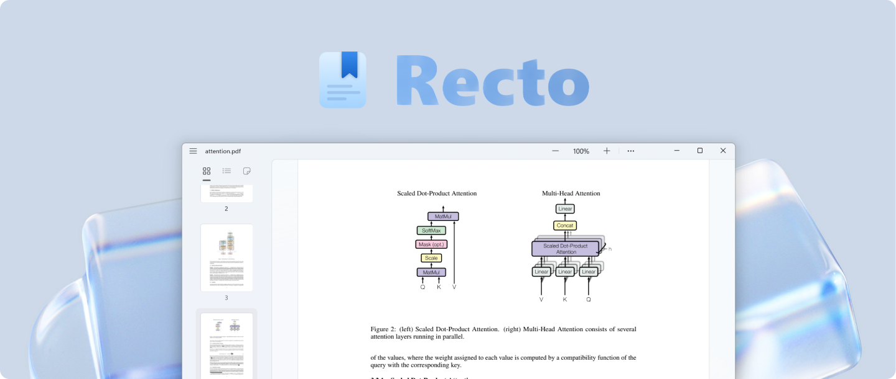
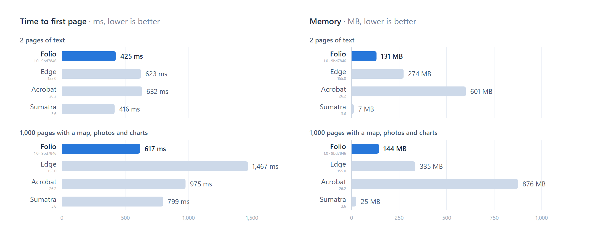

<p align="center">
  
</p>

A simple PDF viewer for Windows 11, modeled on [GNOME Papers](https://apps.gnome.org/Papers/) and built with WinUI 3.

## Building from source

```powershell
dotnet build src/Folio/Folio.csproj -c Release
```

## Performance

<p align="center">
  
</p>

Measured with the [benchmark tool](docs/tools.md#benchmark).

## Credits

- [GNOME Papers](https://apps.gnome.org/Papers/) for inspiration
- [PDFium](https://pdfium.googlesource.com/pdfium/) for PDF rendering

## License

[MIT License](LICENSE) · [Third-party notices](THIRD-PARTY-NOTICES.md)
